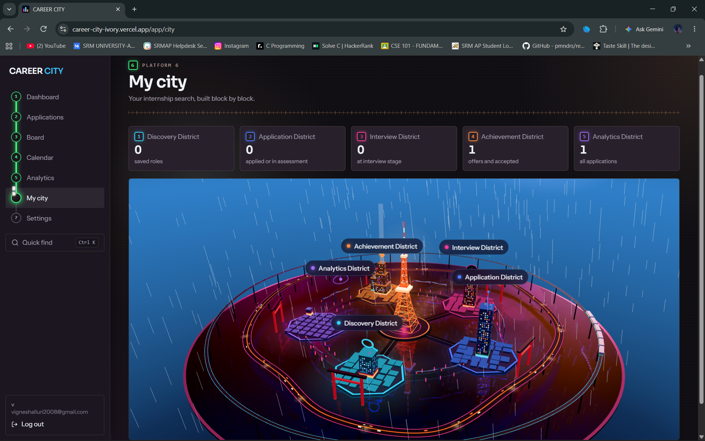
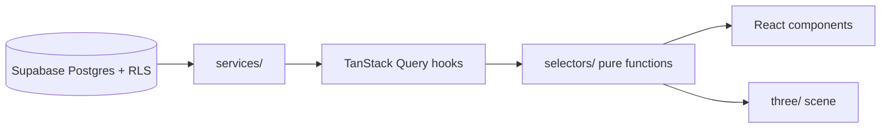

# CAREER CITY

> An internship tracker where every application becomes a building in your own 3D city.

A full-stack portfolio project. A public landing page tours an interactive 3D Tokyo-at-night city built in React Three Fiber. Behind a login is a real tracker: dashboard, applications, Kanban board, calendar and analytics, backed by Supabase (Postgres with Row Level Security). The **My city** page then draws *your* data as a city: one application, one building.

<!-- Add screenshots to docs/screenshots/ and link them here, for example:

 -->

## Features

- **3D landing page**: five districts (Discovery, Application, Interview, Achievement, Analytics) toured by scrolling. Hover and click to explore. Rain, a Tokyo Tower, torii gates, rooftop signs and reflective wet streets.
- **Living city**: a low sun opposite the camera swings around and flares as you scroll, lighting the buildings and laying a glitter path on the wet streets. Moving the mouse over the city sends ripples across the ground. Buildings have shopfronts, awnings, floor ledges, glowing corner strips and rooftop machinery.
- **Sleek dark theme**: 60% dark slate, 30% indigo and 10% bright sky-cyan. The accent is kept scarce (primary buttons, links, the active menu item) so it stays sharp. The 3D city keeps its own neon Tokyo colours.
- **Tactile app**: layered shadows, click ripples, a cursor glow on cards, page transitions and a lifted drag overlay on the Kanban board. All of it is switched off for visitors who prefer reduced motion.
- **Make it yours**: pick an accent colour (sky, violet, emerald, amber, rose), compact or comfortable spacing, the week start and calendar view, which dashboard sections and board columns to show, and whether the water cursor is on. Quick find (Ctrl+K) jumps anywhere, adds things and opens any application by name. Keyboard shortcuts: N new application, R new reminder, / search, G then D/A/B/C/Y/M/S to go to a page, ? for the full list.
- **Calendar**: month, week and agenda views, type filters, drag an event onto another day to reschedule it (a deadline moves its application's deadline), double-click a day to add a reminder, arrow keys and T to move around.
- **Two palettes**: *Dusk* (graphite and aubergine surfaces with warm hairlines, the default) and *Night blue* (the original), switchable in Settings. Only the workspace follows the palette; the landing page keeps its own look.
- **A station-signage design language** (workspace only): navigation is a metro line with a small train that rolls to the page you open; every page starts with a platform sign and a rail along which a train runs once; applications are train tickets (notched edges, dashed perforation, the status as a station number); board columns are platforms and cards roll in like arriving trains; conversion rates are drawn as a train whose windows light up; railway signal lights show what needs attention; and a commuter train circles the 3D city. Shapes are sharp (small radii), labels are mono capitals, buttons have a visible edge and press down. All animation is CSS transforms that run once, and it is off for visitors who prefer reduced motion.
- **A dashboard with a Tokyo identity**: the pipeline is drawn as a metro line (stations are stages, the track glows to your furthest application), deadlines and reminders are station departure boards, and your applications stand as a skyline, one building each, taller the further along. All of it comes from real data.
- **Your data is yours**: export applications and reminders as CSV from Settings. Cells that start with `=`, `+`, `-` or `@` are neutralised so a malicious company name cannot run as a spreadsheet formula.
- **Natural water**: the wet ground in the 3D city is a real wave simulation (rain makes rings, the cursor leaves a wake, a click drops a stone), and the workspace has a matching glassy cursor trail.
- **Tracker**: create, edit and delete applications; a drag-and-drop Kanban board with optimistic updates; a calendar of deadlines and reminders; analytics charts; dashboard stats with their definitions shown on screen.
- **My city**: your applications drawn as buildings. Districts grow outward from their landmark; a full district grows taller.
- **Accounts**: email and password sign-up, protected routes, and per-user data isolation enforced by the database.
- **Accessible and robust**: reduced-motion support, a phone-friendly lighter 3D path, a WebGL fallback, loading, error and empty states everywhere.

## Tech stack

| Area | Tools |
|---|---|
| App | React 19, TypeScript, Vite, React Router |
| 3D | Three.js, React Three Fiber v9, drei v10 |
| Motion | GSAP + ScrollTrigger, Framer Motion |
| Data | Supabase (Auth, Postgres, RLS), TanStack Query, Zustand |
| Forms | react-hook-form, zod |
| UI | Tailwind CSS v4, dnd-kit, Recharts, Lucide |
| Quality | Vitest, GitHub Actions |

## Architecture



The rules that keep it tidy:

- **Only `services/` talks to Supabase.** Screens depend on the `ApplicationService` interface, so the storage could change without touching them (Phase 5 used browser storage; Phase 6 swapped in Supabase by changing one line).
- **Only `three/` imports Three.js**, and it is lazy-loaded, so the dashboard never downloads it.
- **3D components never query the database.** They receive plain numbers from `selectors/city.ts`.
- **GSAP never sets React state in the render loop.** Scroll writes into a mutable object that the camera reads each frame.
- **Selectors are pure functions**, which is why they are easy to test.

## Run it locally

You need Node 20 or newer and a free [Supabase](https://supabase.com) project.

```bash
npm install
```

1. In Supabase, run the SQL files in `supabase/migrations/` in order (SQL editor, or the Supabase CLI).
2. Copy `.env.example` to `.env.local` and fill in your project URL and **public** key (Project Settings, then API Keys).
3. For development, turn **off** Authentication, then Sign In / Providers, then Email, then "Confirm email" (the built-in email sender is heavily rate limited), and set the Site URL to `http://localhost:5173`.
4. `npm run dev`

| Command | What it does |
|---|---|
| `npm run dev` | Start the dev server |
| `npm run typecheck` | Type-check the whole project |
| `npm test` | Run the unit tests once |
| `npm run build` | Type-check and build for production |
| `npm run preview` | Serve the production build locally |

## Security

- Only the Supabase **public (anon/publishable) key** is in the browser. The `service_role` key is never used anywhere in this project. `.env.local` is git-ignored.
- **Row Level Security** is on for every table. Policies allow a user to read and change only rows where `user_id` equals their own id. A reminder linked to an application is rejected unless that application is also theirs.
- Database `CHECK` constraints mirror the form rules (lengths, allowed values, "applied date required once you leave Saved"), so a hand-made request cannot store bad data.
- The route guards in the browser are only a convenience. The real protection is the database.

### Keeping secrets out of the repository

- `npm run secrets` scans every file git would commit for private keys, secret tokens, database passwords, secret-looking files (`.env.local`, `*.pem`, `.npmrc`) and a weak `.gitignore`. It never prints the secret it finds, only the first few characters and the length. `npm run secrets:dist` scans the built website, where the public key is expected but a `service_role` key would be a disaster. Both run as part of `npm run check` and in CI, and the rules are covered by tests (`scripts/secretScan.test.mjs`).
- Anything named `VITE_...` is **copied into the website** and visible to every visitor. Only the public key may ever be a `VITE_` variable. Secrets belong only in server-side settings, and this project has no server.
- The public (anon/publishable) key is safe in a browser **because Row Level Security is on**. It is still kept in `.env.local` and the Vercel settings, never in committed files.
- If a real secret is ever pushed, deleting it in a later commit is not enough, because it stays in the history. Create a new key in the provider's dashboard and delete the old one first.
- On GitHub, turn on **Secret scanning** and **Push protection** (Settings, Code security).

## Tests

`npm test` runs Vitest on the pure logic: all the selectors (dashboard stats, analytics and conversion rates, filtering and sorting, calendar events, city metrics), the city generation (layout, windows, sign placement, growth from data), the water simulation, CSV export (including spreadsheet-formula injection protection), the friendly database error messages, and the mapping between database rows and app types, the railway-signal rules, the sidebar's active station, the train meter, the half-float conversion used to send water to the graphics card, the next-departure pick, search highlighting, the activity summary, the calendar range summary, the train's placement maths, the effects plan (what each quality level switches on), and every form validation rule (limits that match the database, link and date checks, the "date applied" rule, password rules). Not covered yet: React components, and the Supabase calls themselves (they need a test database).

## Performance

- Three.js is code-split with `React.lazy`; the city is built from instanced meshes, so the whole scene is a few dozen draw calls. Phones get a lighter city (fewer buildings, no fog, no mirror reflections, less rain).
- The 3D loop pauses (`frameloop="never"`) when the city is scrolled off-screen.
- **Adaptive effects:** the 3D city measures its own frame rate (drei's `PerformanceMonitor`). It lowers the pixel density smoothly when frames get slow and, in Auto mode, switches the heaviest effects off for the rest of the visit: the mirror reflections (they draw the city a second time) and the large water simulation (cost grows with the square of its width). Settings has Auto, Full and Light.
- **The workspace water cursor** keeps a simulation of one cell per 4 screen pixels. That is affordable because `WaterSim` only works on the rectangle where water is moving (`activeBounds`), so the cost follows the size of the ripples, not the size of the screen. The graphics card (WebGL 2) works out the lighting at every screen pixel, which is why the ripples are smooth instead of blocky; browsers without WebGL 2 get a plain canvas version. Its strength is a setting (Subtle, Normal, Lively), which scales how hard the cursor pushes the water and how bright the ripples are drawn. It steps down to 6, then 8 pixel cells if frames are slow (Settings shows which mode is running), hides its canvas while the water is calm, and is off on My city, which has its own 3D water.
- **Code splitting:** only the landing page is in the first download. Every workspace page, the login screens, the charts, the drag-and-drop code and the 3D city are fetched when first opened (`src/routes/index.tsx`). Look at the file sizes at the end of `npm run build` to see the effect. After a new deployment, an old open tab may ask for a page file that no longer exists; the error page offers a reload.
- **Check frames per second:** add `?fps` to any page address (for example `http://localhost:5173/?fps`) for a live counter.
- **Lighthouse:** run `npm run build && npm run preview`, open the preview in Chrome and run Lighthouse from DevTools (Mobile and Desktop). Record your scores here once measured.

## Deploy (Vercel)

Before deploying, run `npm run check`. It does exactly what the host will do (typecheck, tests, production build), so a failure shows up on your computer instead of in a failed deployment.

1. **Put the code on GitHub.** Create an empty repository on github.com (no README, no .gitignore), then in the project folder:
   ```
   git init
   git add .
   git commit -m "Career City"
   git branch -M main
   git remote add origin https://github.com/YOUR-NAME/career-city.git
   git push -u origin main
   ```
   Check that `.env.local` is NOT in the commit (`.gitignore` covers it) and that `package-lock.json` is.
2. **Create the site on Vercel.** Add New Project, import the repo. The Vite preset is detected (build command `npm run build`, output `dist`). `vercel.json` already makes deep links like `/app/board` work.
3. **Add the two environment variables** in Vercel (Settings, Environment Variables): `VITE_SUPABASE_URL` and `VITE_SUPABASE_ANON_KEY`. Use the public publishable key only, never the service_role key. Redeploy after adding them.
4. **Tell Supabase about the live address.** Authentication, URL Configuration: set **Site URL** to your Vercel address and add it to **Redirect URLs** (keep `http://localhost:5173` there for development).
5. Turn **Confirm email** back on for production.
6. Visit the live address, register, add an application, and reload a deep link such as `/app/board` to confirm it works.

## Known limitations

- Conversion rates use each application's *current* status because there is no status history yet.
- Rejected applications are counted in Analytics but not drawn as buildings.
- Reflections use a mirror plane, which costs an extra render pass, so they are desktop-only.
- No data import from the old browser-storage version.

## Project structure

```
src/
  animation/   scroll and camera rig
  auth/        AuthProvider, route guards
  components/  ui kit, forms, layout
  config/      district definitions
  hooks/       data hooks
  lib/         client setup and helpers
  pages/       landing, auth, app screens
  selectors/   pure functions (tested)
  services/    the only code that talks to Supabase
  store/       small shared state
  three/       the 3D city
  types/       domain types, form schemas, generated database types
supabase/migrations/   the database schema and policies
```

📸 Screenshots

🏠 Landing Page

"Landing Page" (docs/screenshots/landing.png)

📊 Dashboard

"Dashboard" (docs/screenshots/dashboard.png)

🗂️ Board

"Board" (docs/screenshots/board.png)

🌆 My City

"My City" (docs/screenshots/my-city.png)
